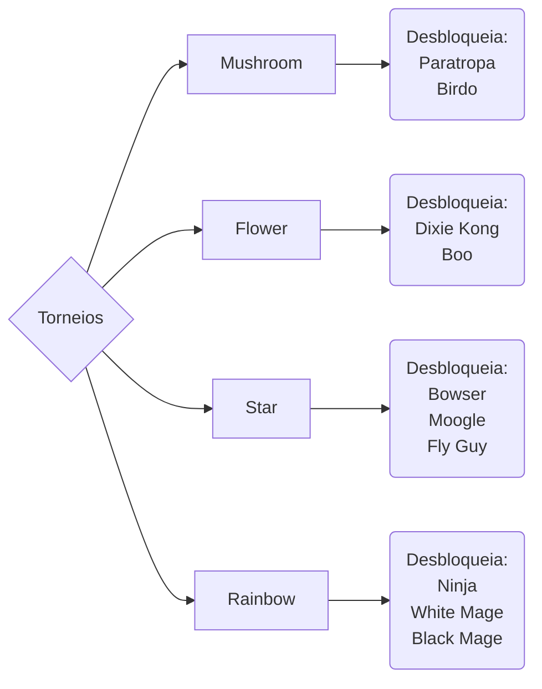

# Mario Hoops 3-on-3

### Introdução
Released 2006 for the nintendo DS, published by Nintendo and developed by Square Enix.

### Personagens
* Disponiveis no inicio
    * Mario 
    * Luigi
    * Yoshi
    * Peach
    * Daisy
    * Waluigi
    * Donkey Kong
    * Wario
    * Bowser Jr.
    * Diddy Kong 
* Desbloqueaveis
    * Birdo
    * Ninja
    * White Mage
    * Bowser
    * Dixie Kong
    * Cactuar
    * Paratroopa
    * Boo
    * Fly Guy
    * Moogle
    * Black Mage

### "Enredo"
O jogo não tem um modo história, mas no seu lugar tem um modo de torneio de 8 equipas onde são jogados 3 jogos. Existem 4 torneios por onde escolher cada um desbloqueando personagens.

#### Referencias
[wiki do jogo](https://www.mariowiki.com/Mario_Hoops_3-on-3#Tourney)
...